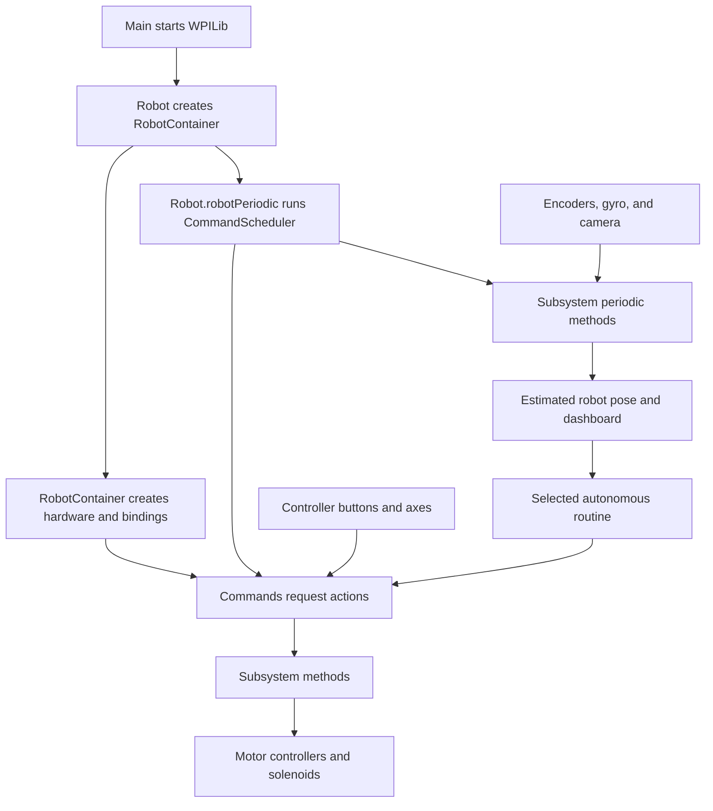

# Understanding the 2026 competition robot

This guide explains the Java program in this repository for programmers who already know Java and general programming concepts but may be new to FRC, WPILib, or this robot. It describes the checked-in source and current working-tree changes. Hardware behavior still depends on wiring, calibration, and device configuration.

The robot is Team 772's 2026 FRC robot. FRC is the FIRST Robotics Competition. The **roboRIO** is the computer on the robot that runs this program. A driver uses the **Driver Station** application to select robot modes and provide joystick input. Motor controllers receive requests from the program and apply electrical power to motors.

The program's main jobs are to:

- Drive four independently steered wheels, called a **swerve drivetrain**.
- Move an intake arm and run its roller.
- Create and monitor shooter motor controllers, although shooter controls are unfinished.
- Estimate the robot's location using wheel encoders, a gyro, and a camera.
- Follow autonomous paths selected on the dashboard.

## Reading order

Read these pages in order the first time. Each page also works as a reference when you return to the code.

| Page | What you will learn |
| --- | --- |
| [1. FRC and control-system foundations](01-foundations.md) | Robot runtime, hardware interfaces, units, coordinate frames, and feedback control |
| [2. Startup, modes, commands, and buttons](02-program-flow.md) | Who calls each part of the program and when motor requests happen |
| [3. Swerve driving and heading control](03-swerve-drive.md) | The complete joystick-to-wheel calculation and position tracking |
| [4. Intake, shooter, and climber](04-mechanisms.md) | Mechanism methods, control modes, and unfinished features |
| [5. Vision and autonomous](05-vision-and-autonomous.md) | AprilTags, pose estimates, path files, and autonomous feedback |
| [6. Constants, hardware, and project files](06-configuration.md) | CAN IDs, configuration values, units, and repository layout |
| [7. Building, testing, and making changes](07-development.md) | A practical workflow, existing tests, troubleshooting, and known limitations |
| [Glossary](glossary.md) | Short definitions of terms used throughout the guide |

## The program in one picture

The arrows describe information and calls, not separate threads. Most Java logic here runs as short pieces of work during repeated robot loops. Motor controllers also run their own internal control logic after receiving a request.

## Follow one action first

Start with the intake roller; it avoids the swerve mathematics:

1. In [RobotContainer.java](../src/main/java/frc/robot/RobotContainer.java), `feedingToggle` represents driver button 7 and `slowIntakeRollers` represents manual-controller button 4.
2. `configureIntakeRollerBindings()` combines the two buttons. Either button can request the roller, but only while teleop is enabled.
3. A command repeatedly calls `manualIntakeRoller(0.4)` while that combined condition is true.
4. In [IntakeSubsystem.java](../src/main/java/frc/robot/subsystems/IntakeSubsystem.java), that method calls `intakeRoller.set(speed)`.
5. When the command ends, its cleanup callback requests zero output.

The value `0.4` is 40% output, not 40% of a guaranteed RPM. Actual speed depends on the motor, load, battery, and controller configuration.

## How to use this guide alongside the source

Links point to real source files using paths relative to `docs/`. Keep the source open next to the matching chapter. Search for the method names shown in backticks. A method's name tells you its intended purpose; its body and its callers tell you what currently happens.

Examples labeled “illustration” explain a concept and are not additional robot code. Values in this guide are current source values, not recommended tuning values. If a value changes, update its documentation too.
