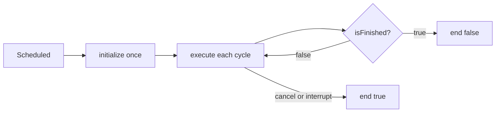

# 2. Startup, modes, commands, and buttons

[Guide index](README.md) · [Previous: foundations](01-foundations.md) · [Next: swerve](03-swerve-drive.md)

## Startup: `Main` → `Robot` → `RobotContainer`

[Main.java](../src/main/java/frc/robot/Main.java) contains Java's entry point, `main`. `RobotBase.startRobot(Robot::new)` hands control to WPILib and supplies a way to construct the robot object.

[Robot.java](../src/main/java/frc/robot/Robot.java) extends `TimedRobot`. Its constructor creates one `RobotContainer` and disables CTRE's automatic signal logging through `SignalLogger.enableAutoLogging(false)`.

[RobotContainer.java](../src/main/java/frc/robot/RobotContainer.java) owns the main hardware subsystems, controller objects, button triggers, and autonomous chooser. Its field initializers construct the drivetrain, intake, shooter, and climber valve before the constructor loads autonomous settings.

The constructor then:

1. Loads PathPlanner's robot configuration from the deployed GUI settings.
2. Reports an error if loading fails. When no configuration is available, it creates a chooser with a do-nothing command so teleop setup can continue.
3. If configuration loaded, configures PathPlanner and builds its autonomous chooser.
4. Requests the climber solenoid's forward state.
5. Installs `TeleoperatedControlCommand` as the drivetrain's default command.
6. Publishes the chooser to SmartDashboard and installs button bindings.

The settings-loading `try/catch` does not surround every later startup operation. It is a fallback for a failed settings load, not a guarantee that every malformed auto or hardware problem is recoverable.

## Robot modes

WPILib calls the `...Init()` callback on entering a mode and the `...Periodic()` callback repeatedly while in that mode. `robotPeriodic()` also runs across modes, including disabled.

| Callback | Current behavior |
| --- | --- |
| `robotPeriodic()` | Runs `CommandScheduler.getInstance().run()`. |
| `autonomousInit()` | Gets the selected auto and schedules it if non-null. |
| `teleopInit()` | Cancels the stored auto command, then sets the heading-hold target to the current gyro heading. This prevents returning to a stale pre-auto target. |
| `testInit()` | Cancels all commands currently scheduled. |
| Other mode callbacks | Currently empty; they do not add custom behavior. |

Disabled mode suppresses physical motor operation through the robot control system. The scheduler still runs subsystem periodic methods and polls bindings, but ordinary commands are not allowed to run while disabled. Cleanup on cancellation is still important because a motor controller request is stateful.

`testInit()` cancels commands once; it does not permanently stop the scheduler or disable all bindings. The drivetrain default command itself refuses to drive outside enabled teleop.

## Subsystems and commands

A **subsystem** groups the hardware and operations of a mechanism. A **command** describes an action over time. A subsystem might provide `moveIntake(target)`; a command decides when to call it repeatedly and when to stop.

A command can declare **requirements**, identifying the subsystems it needs exclusive control of. The scheduler normally interrupts a conflicting command when a new command needs the same subsystem. Requirements are not automatic: calling a subsystem method inside an arbitrary lambda does not add them.

A command's lifecycle is:

`end(false)` means normal completion. `end(true)` means interruption or cancellation. Both should leave controlled hardware in the intended state.

The drivetrain's default command declares the drivetrain as a requirement. When an auto requires the drivetrain, that auto takes control. When no command needs it, the scheduler can schedule the default again. A default command is not inherently limited to teleop, so `TeleoperatedControlCommand.execute()` explicitly checks `DriverStation.isTeleopEnabled()`.

## The command helpers in this code

| Helper | Meaning |
| --- | --- |
| `new InstantCommand(action)` | Performs an action once and finishes. It does not keep checking a sensor. |
| `subsystem.runEnd(action, cleanup)` | Runs `action` repeatedly, runs `cleanup` on ending, and requires that subsystem. |
| `Commands.runEnd(action, cleanup)` | Same repeated-action pattern; requirements must be supplied explicitly if needed. |
| `command.until(condition)` | Ends the wrapped action when the condition becomes true. |
| `Commands.none()` | A command that does no useful work and finishes. |
| `command.cancel()` | Requests cancellation and cleanup if scheduled. |

`intakePositionCommand(target)` returns an intake-owned `runEnd` command. Its repeated action calls `moveIntake(target)`; its cleanup calls `manualIntakePosition(0)`. This is necessary because `moveIntake()` makes only one position check per invocation.

The roller uses `Commands.runEnd` without the intake subsystem requirement. That is intentional: the arm and roller must operate together even though both are housed in `IntakeSubsystem`. The single combined roller binding coordinates the two existing roller inputs. Any future roller command will need a coordination strategy; splitting arm and roller into separate subsystems is one possible design.

## Triggers and button transitions

A `Trigger` is a condition checked by the scheduler. `JoystickButton(controller, number)` provides a trigger tied to one raw button.

- `onTrue(command)` schedules when the condition changes from false to true.
- `onFalse(command)` schedules when it changes from true to false.
- `whileTrue(command)` schedules on the rising edge and cancels on the falling edge. It does not repeatedly restart a command that finishes or is interrupted while the button remains held.
- `a.or(b)` is true when either condition is true.
- `a.and(b)` requires both conditions.

For the roller, `(driver button 7 OR manual button 4) AND teleop enabled` creates one condition. Releasing only one held button leaves it true. Disabling makes it false and ends the motor command. Entering enabled teleop while a button is held makes it true again.

## Active controls

Controller slots are Driver Station indices, not USB port labels. Raw button numbers depend on the controller model.

| Slot | Input | Current action |
| --- | --- | --- |
| 0: driver | Axis 1 | Negated forward/backward input |
| 0: driver | Axis 0 | Negated sideways input |
| 0: driver | Axis 4 | Rotation input, not negated |
| 0 | Button 5 | Set the diagonal heading target with `humpRot()` |
| 0 | Button 8 | Reset the gyro heading and heading-hold target |
| 0 | Button 1 | Track intake arm position −1.28 while held; stop on release |
| 0 | Button 4 | Track intake arm rest position −0.75 while held; stop on release |
| 0 | Button 7 | Request roller output 0.4 while held in enabled teleop |
| 0 | Button 2 | Request the heading computed by `rotateToHub()` |
| 1: test | Button 1 | Track −1.28 while held; on release, return toward zero until within 0.05 |
| 2: manual | Button 4 | Same roller request as driver button 7 |
| 2 | Button 8 | Arm output +0.2 while held |
| 2 | Button 7 | Arm output −0.2 while held |

The test-controller arm release action continues after releasing the button until it reaches its tolerance or is interrupted. The other arm bindings stop on release.

If two arm commands compete, they share the intake requirement. The newer command can interrupt the older one. Releasing the newer button does not automatically resume an older `whileTrue` command; another button transition is needed.

The explicit teleop gate applies to joystick driving and the combined roller binding. Other active button bindings are not all mode-gated, so controller input can schedule arm or heading actions in other enabled modes. Do not assume “driver controls” in a comment creates a mode restriction.

Several fields have suggestive names but no binding: shooter toggles, auto aim, turret controls, slow tower/flywheel/feeder, and hood controls. The climber toggle and slow-drive bindings are commented out. Declaring a trigger does not cause an action by itself.

## What runs in a typical scheduler cycle

At a high level, the scheduler calls registered subsystem periodic methods, polls its button loop, runs scheduled commands, handles their endings, and schedules available default commands. Default commands may begin executing on the following scheduler pass.

This ordering explains why telemetry can show a measurement taken before the latest command output in the same cycle. Avoid designing logic that depends on the registration order of unrelated subsystems. In this project, the drivetrain explicitly requests vision measurements during its own pose update.
